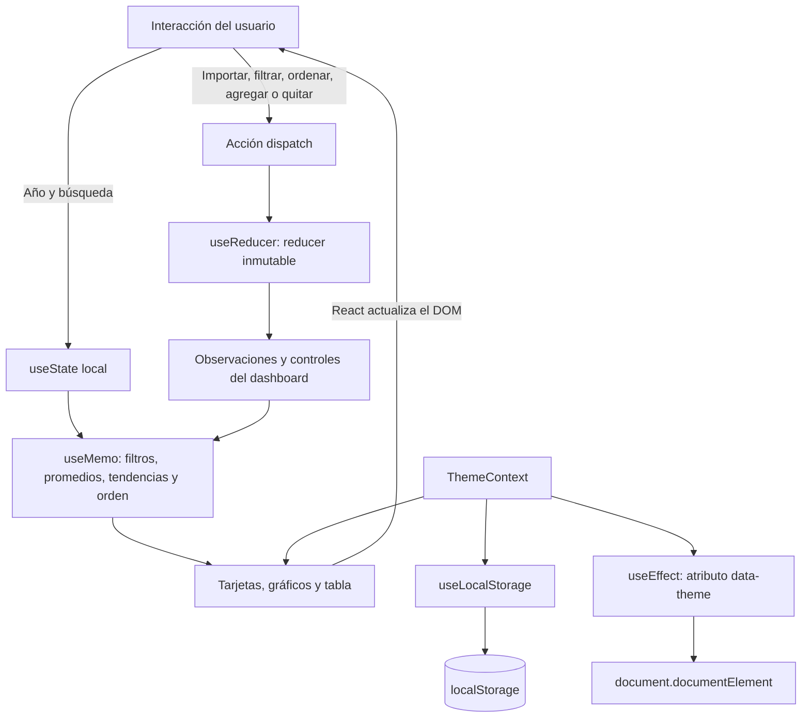
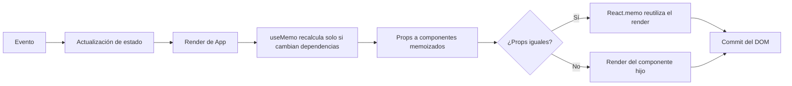

# Observatorio ENAHO

Dashboard frontend en React para explorar indicadores sociales y económicos por departamento y año. Incluye tarjetas KPI, tendencias, comparativos, tabla filtrable/ordenable, modo oscuro, carga CSV y edición de observaciones.

> **Importante sobre las cifras:** el proyecto no contiene microdatos oficiales ENAHO. La vista inicial usa valores **demostrativos inventados** para que la interfaz funcione al abrirla. No son estimaciones ni resultados publicados por INEI. Importa un CSV construido a partir de microdatos procesados y documenta el diseño muestral y las ponderaciones antes de presentar resultados como oficiales.

## Inicio

Requiere Node.js 20.19+ o 22.12+.

```bash
npm install
npm run dev
```

El servidor local muestra la URL para abrir el dashboard. Para comprobar el proyecto:

```bash
npm run lint
npm test
npm run build
```

## Importar datos ENAHO

Pulsa **Importar datos** y selecciona un CSV UTF-8. Cada fila representa un departamento y un año. Los encabezados requeridos pueden escribirse en inglés o español:

| Campo en inglés | También acepta | Unidad |
| --- | --- | --- |
| `department` | `departamento`, `region` | Nombre del departamento |
| `year` | `anio`, `año`, `periodo` | Año |
| `povertyRate` | `pobreza`, `pobreza_monetaria` | Porcentaje, 0–100 |
| `monthlyIncome` | `ingreso`, `ingreso_mensual` | Soles |
| `employmentRate` | `empleo`, `tasa_empleo`, `ocupacion` | Porcentaje, 0–100 |
| `educationYears` | `educacion`, `anios_educacion` | Años promedio |
| `waterAccess` | `agua`, `acceso_agua` | Porcentaje, 0–100 |
| `electricityAccess` | `electricidad`, `acceso_electricidad` | Porcentaje, 0–100 |
| `internetAccess` | `internet`, `acceso_internet` | Porcentaje, 0–100 |

Los nueve campos son obligatorios; los porcentajes deben estar entre 0 y 100. `public/sample-enaho.csv` sirve como plantilla de formato y usa solo valores inventados. El importador sustituye la muestra en memoria; al recargar, vuelve la vista demostrativa.

## Indicadores y metodología

- Para **Todos los departamentos**, las tarjetas y servicios muestran el promedio simple de las filas departamentales del año seleccionado; no se pondera por población ni por factores de expansión.
- Al elegir un departamento, las tarjetas y el resumen de servicios se limitan a ese departamento.
- La variación de las tarjetas es la diferencia frente al año calendario anterior, expresada como puntos porcentuales para tasas.
- La tendencia usa el promedio simple de las filas disponibles de cada año. El comparativo regional muestra los departamentos con el valor más alto del indicador elegido.
- La tabla permite buscar, ordenar por encabezado, agregar una observación con todos sus indicadores y quitar filas. Agregar o quitar afecta únicamente los datos en memoria.

Para obtener estimaciones ENAHO defendibles, prepara agregados a partir de los microdatos, aplica los factores de expansión y las definiciones oficiales correspondientes, y registra la fuente, el periodo y cualquier tratamiento de valores faltantes. El dashboard no calcula estimaciones complejas de encuestas ni transforma los microdatos crudos.

## Hooks aplicados

- **`useReducer`** centraliza las observaciones y sus acciones (`ADD`, `REMOVE`, `REPLACE_DATA`, `FILTER`, `SORT`, `SET_METRIC`); sus actualizaciones son inmutables. Se prefiere a un solo `useState` porque hay varios campos relacionados y acciones que transforman la misma colección. El reducer concentra y hace comprobables esas transiciones; `useState` simple sigue siendo apropiado para estado local independiente como el texto de búsqueda o la apertura del diálogo.
- **`useState`** gestiona controles de interfaz independientes, selección de periodo, búsqueda, carga y formularios.
- **`useContext`** comparte la preferencia de tema con el dashboard, sin pasarla por cada componente.
- **`useEffect`** mantiene el atributo del tema, escucha y desregistra Escape en el diálogo y la combinación Ctrl/⌘+K para el buscador, y mantiene la opción de periodo válida al importar.
- **`useMemo`** calcula opciones, promedios, comparaciones y series a partir de dependencias explícitas.
- **`useCallback`** conserva los handlers que se pasan a componentes memoizados.
- **`useRef`** abre el selector de archivos sin mostrar el input y enfoca el primer campo del diálogo.
- **Hook personalizado `useLocalStorage`** persiste el tema claro/oscuro, informa errores en consola y permite actualizar con valor o función.
- **`React.memo`** evita renders innecesarios de tarjetas, filas e iconos cuando sus props no cambian.

La limpieza de efectos (listeners y atributo del tema) está activa. El panel **React Profiler** al final de la página usa la API oficial `React.Profiler` para registrar commits y duraciones durante interacciones; permite ver los últimos commits y descargar el registro JSON.

## Diagramas de estado y render





## Validación y evidencia de entrega

Para repetir las comprobaciones técnicas:

- `npm run lint`: ESLint; `react-hooks/exhaustive-deps` se trata como error.
- `npm test`: parser de CSV y acciones inmutables del reducer.
- `npm run build`: compilación de producción.

### Evidencia de profiling

La sesión del panel integrado y la comprobación de cleanup están resumidas en [`evidence/PROFILER.md`](./evidence/PROFILER.md); la captura está en [`evidence/react-profiler.png`](./evidence/react-profiler.png).

1. Abre el panel **React Profiler** al final del dashboard, pulsa **Iniciar grabación**, cambia el periodo y ordena la tabla.
2. Pulsa **Detener y guardar**. El panel lista commits y duraciones medidas por `React.Profiler`; **Descargar evidencia JSON** guarda el registro de la sesión.
3. Para la evidencia exigida específicamente por la guía, abre React DevTools → **Profiler → Record**, repite las interacciones, detén la grabación y toma capturas de la vista de commits y de los componentes que se renderizaron. El panel integrado sirve como medición complementaria y no pretende hacerse pasar por una captura de React DevTools.
4. Explica tus capturas con tus propias palabras. En este dashboard, seleccionar otro periodo actualiza métricas y tabla; ordenar puede actualizar la lista, mientras que los componentes memorizados con props sin cambios pueden omitir renders. Confirma la diferencia en el Profiler: no se afirma que `useMemo` o `useCallback` reduzcan trabajo si la grabación no lo demuestra.

### Evidencia de cleanup

1. Pulsa **Agregar**, comprueba que el campo de departamento recibe el foco.
2. Pulsa Escape: el diálogo se desmonta y su listener de teclado se elimina mediante el cleanup del `useEffect`.
3. Pulsa Escape otra vez con el diálogo cerrado: no se abre ni modifica ningún estado. Repite la apertura y el cierre para comprobar que el listener no se acumula. Revisa la consola del navegador.

El dashboard ya fue verificado durante la implementación en el navegador para carga de CSV, filtro departamental, selección de indicador y foco del diálogo. Ejecuta las comprobaciones indicadas después de cualquier cambio.

El ZIP de entrega debe excluir `node_modules` y `.venv`; se reinstalan dependencias con `npm install`. La publicación del repositorio en GitHub y la subida del ZIP/RAR a ADESA requieren la cuenta y credenciales del alumno, por lo que deben realizarse desde sus propios servicios. No se incluyen credenciales ni se afirma que esos envíos se hayan efectuado.
